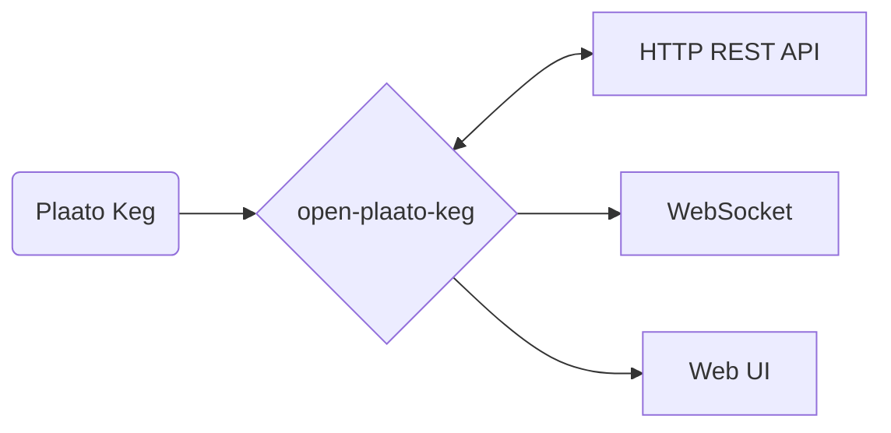

<a href="https://www.buymeacoffee.com/LocutusOFB"></a>

## What is Open Plaato Keg?

Take local control of your **Plaato Keg** scale. This reverse-engineered server replaces the
discontinued Plaato cloud, decoding the Blynk TCP protocol so your keg keeps working with no
external dependencies.

This build is **keg weights only**. It focuses on two jobs:

- **Kegging** — filling a fresh keg: calibrate the empty keg, set the full volume, watch it fill.
- **Serving** — pouring from up to three kegs on tap: beer name, tare, and beer-left, laid out
  for a tablet in landscape but usable on phone and desktop.

There is no fermentation/airlock support, no CO₂ mode, no tap-list/beverage database, and no
MQTT/BarHelper/Brewfather/Grainfather integrations in this build.

## Why this exists

Plaato stopped manufacturing its homebrew equipment and shut down the cloud backend the app
relied on ([announcement](https://plaato.io/plaato-for-homebrewers/)). Without a replacement the
hardware is a paperweight. Open Plaato Keg is that replacement for the Keg scale.

## How it works

The Plaato Keg talks to a Blynk server over a plain TCP socket. Open Plaato Keg is a local
stand-in for that server: it terminates the socket, decodes the Blynk wire protocol and the
Plaato virtual-pin layer, stores keg state in an Erlang `:dets` file, and exposes it over an
HTTP REST API and a WebSocket.



## Setup

### Point the Plaato Keg at your server

Reset the Keg with the yellow "Reset Key" from the box (a weak fridge magnet works too).
Steps, from Plaato's own docs
([reset](https://intercom.help/plaato/en/articles/5004706-reset-the-plaato-keg),
[setup](https://intercom.help/plaato/en/articles/5004700-how-to-set-up-a-plaato-keg)):

1. Power on the Keg — all three LEDs blink slowly.
2. Remove the yellow "Reset Key" from the bottom.
3. Hold it in the "Reset" hole for ~5 seconds (or hold a fridge magnet over the two pins).
4. The LEDs turn off and come back on.

Then configure it:

1. Join the `PLAATO-XXXXX` Wi-Fi hotspot the Keg exposes.
2. Open <http://192.168.4.1>.
3. Enter:
   - **Wi-Fi SSID** (2.4 GHz only) and **password**
   - **Auth token** — a 32-character hex string (`0-9`, `a-f`). This is the keg's ID; pick a
     different one per keg if you have more than one.
   - **Host** and **port** of your Open Plaato Keg install (port = `KEG_LISTENER_PORT`, default `1234`).

   Or in one HTTP GET:

   ```
   http://192.168.4.1/config?ssid=My+Wifi&pass=my_password&blynk=00000000000000000000000000000001&host=192.168.0.123&port=1234
   ```

### First run: set up the scale

Open the web UI and go to **Keg Devices**. A newly connected scale shows a "Needs setup" badge.
Give it a name, run the known-weight calibration, set a default full volume and sensitivity.

## Deployment

### Docker

Multi-arch images (`linux/amd64`, `linux/arm64`) are published to GitHub Container Registry —
works on x86-64 servers, Raspberry Pi 4/5 (64-bit), Apple Silicon, and AWS Graviton.

```bash
docker run --rm -it -p 1234:1234 -p 8085:8085 ghcr.io/wesenrog/open-plaato-keg:latest
```

### Docker Compose

```yaml
services:
  open_plaato_keg:
    image: ghcr.io/wesenrog/open-plaato-keg:latest
    container_name: open_plaato_keg
    ports:
      - 1234:1234
      - 8085:8085
    restart: always
    volumes:
      # Persist the database across container updates.
      - ./data:/db
    environment:
      - DATABASE_FILE_PATH=/db/keg_data.bin
      - KEG_LISTENER_PORT=1234
      - HTTP_LISTENER_PORT=8085
```

### Elixir release

If you would rather not use Docker, build an
[Elixir release](https://hexdocs.pm/mix/Mix.Tasks.Release.html) (`mix release`) and run it
directly. Use [asdf](https://asdf-vm.com) with the checked-in [.tool-versions](.tool-versions).

### Environment variables

| Name | Requirement | Default | Description |
|---|---|---|---|
| `KEG_LISTENER_PORT` | Optional | `1234` | TCP port for Plaato Keg connections |
| `HTTP_LISTENER_PORT` | Optional | `8085` | HTTP port for the web UI and API |
| `DATABASE_FILE_PATH` | Optional | `priv/db/keg_data.bin` | Path to the `:dets` database file |
| `INCLUDE_UNKNOWN_DATA` | Optional | `false` | Also expose virtual pins that are not mapped to a known property |

## Web UI

Served from `HTTP_LISTENER_PORT`. `/` redirects to the Serving page.

| Page | Path | Purpose |
|---|---|---|
| **Serving** | `/index.html` | Up to three kegs on tap. Per keg: editable beer name, connection/pour status, keg temperature, litres and % left, last pour, and a Tare button. Landscape-tablet layout, responsive to phone and desktop. |
| **Kegging** | `/kegging.html` | One selected connected keg. Big net-weight readout, then a guided flow: set empty keg → set full volume → watch it fill → start the next keg. A collapsible panel holds known-weight calibration, tare, sensitivity and temperature offset. |
| **Keg Devices** | `/devices.html` | One-time setup of each physical scale: name, known-weight calibration, tare, default full volume, sensitivity, temperature offset, and remove-device. Connected but unnamed scales are flagged "Needs setup". |

## HTTP REST API

All responses are JSON. Keg IDs are the 32-character hex auth token.

### Reads

| Endpoint | Description |
|---|---|
| `GET /api/kegs` | All known kegs, one object each |
| `GET /api/kegs/:id` | One keg (404 if unknown) |
| `GET /api/kegs/devices` | IDs of every keg ever seen (connected or not) |
| `GET /api/kegs/connected` | IDs with a live TCP connection right now |
| `GET /api/alive` | `{"status":"ok","version":"x.y.z"}` |

Keg object fields include: `id`, `amount_left` (litres), `percent_of_beer_left`,
`max_keg_volume`, `empty_keg_weight`, `weight_raw` (net kg), `last_pour`, `last_pour_string`,
`is_pouring` (`"0"` / non-zero), `keg_temperature`, `keg_temperature_string`,
`temperature_offset`, `temperature_correction`, `chip_temperature_string`, `sensitivity`,
`wifi_signal_strength`, `firmware_version`, `leak_detection`, `min_temperature` /
`max_temperature`, `beer_left_unit` (`"litre"` or `"kg"`, derived), `internal` (device
metadata), and the locally stored fields `my_label`, `my_sort_order`, `my_display_mode`.

### Commands

Sent to a connected keg unless noted. `503` if the keg is not connected.

| Endpoint | Body | Description |
|---|---|---|
| `POST /api/kegs/:id/tare` | — | Tare (zero) the scale |
| `POST /api/kegs/:id/tare-release` | — | Release the tare hold |
| `POST /api/kegs/:id/empty-keg` | — | Capture the current reading as the empty-keg weight |
| `POST /api/kegs/:id/empty-keg-release` | — | Release the empty-keg hold |
| `POST /api/kegs/:id/empty-keg-weight` | `{"value": 4.0}` | Set the empty-keg weight directly (kg) |
| `POST /api/kegs/:id/max-keg-volume` | `{"value": 19}` | Set the full keg volume (litres) |
| `POST /api/kegs/:id/calibrate-known-weight` | `{"value": 5}` | Load-cell calibration against a known mass (kg) |
| `POST /api/kegs/:id/temperature-offset` | `{"value": -1.5}` | Temperature calibration offset (°C) |
| `POST /api/kegs/:id/sensitivity` | `{"value": "very_low"\|"low"\|"medium"\|"high"}` (or `1`–`4`) | Pour-detection sensitivity |
| `POST /api/kegs/:id/label` | `{"value": "Left keg"}` | Friendly name (local only) |
| `POST /api/kegs/:id/display-mode` | `{"value": "weight_primary"\|"percent_primary"}` | UI preference (local only) |
| `POST /api/kegs/:id/reset-last-pour` | — | Zero the stored last-pour value |
| `POST /api/kegs/order` | `{"ordered_ids": ["id1","id2"]}` | Persist keg sort order (local only) |
| `POST /api/kegs/:id/delete` | — | Disconnect and erase all stored data for a keg |

### WebSocket

`GET /ws` upgrades to a WebSocket. The server pushes:

- a full keg JSON object whenever that keg's data changes, and
- `{"type":"keg_removed","id":"…"}` when a keg is deleted.

## Development

Requires the toolchain in [.tool-versions](.tool-versions) (Elixir 1.16 / OTP 26).

```bash
mix deps.get
mix run --no-halt          # start the server
mix test                   # run the suite (aliased to --no-start)
mix credo --strict         # lint
```

`local/keg_simulator.exs` replays the captured Blynk frames in `local/bin/` against a running
server on port 1234:

```bash
mix run --no-start local/keg_simulator.exs
```

## Protocol

Raw TCP bytes go through three stages:

1. **`BlynkProtocol`** — the binary Blynk wire frame (`cmd`, `msg_id`, `length`, `body`).
2. **`PlaatoProtocol`** — interprets Blynk commands (login/auth token, hardware pin writes,
   internal metadata).
3. **`PlaatoData`** — maps Plaato virtual pins to keg properties (`amount_left`,
   `keg_temperature`, `firmware_version`, …).

`KegCommander` encodes the reverse direction (tare, calibrate, set full volume, sensitivity,
temperature offset) and sends it back over the same socket.
